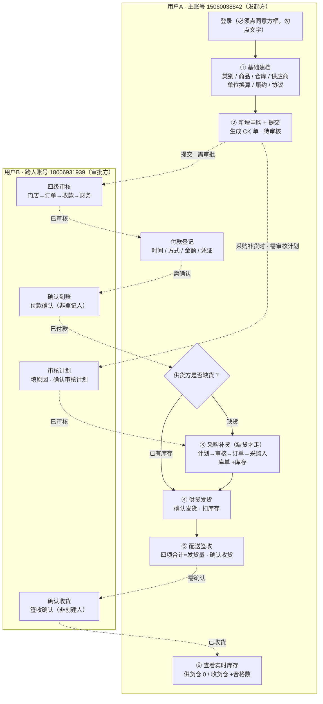

# 采购入库双泳道流程图（两用户交接）

> 适用环境：测试环境 `https://oacs.fzjinkuo.com`（business_id=200242「测试」）
> 两条泳道 = 两个用户；泳道之间的**虚线箭头** = 一个用户完成某步后交接给另一个用户。
> 完整逐步操作见 `docs/采购入库全流程操作手册.md`。

## 交接点速查（虚线箭头）

| 从（用户A） | 动作 | 到（用户B） | 含义 |
|------|------|------|------|
| ② 新增申购提交 | 提交 · 需审批 | 四级审核 | A 提交后 B 逐级审核 |
| ② 新增申购提交 | 需审核计划 | 审核计划 | 走采购补货时 B 先审计划 |
| 付款登记 | 需确认 | 确认到账 | B 付款确认（非登记人） |
| ⑤ 配送签收 | 需确认 | 确认收货 | B 签收确认（非创建人） |
| —— 反向 —— | 已审核 / 已付款 / 已收货 | 回到 A 继续 | B 完成后泳道交回 A |

⚠️ 纪律：创建人不能审自己的单（自审必 403/409）；付款登记与确认到账不能是同一人（三权分立）。
