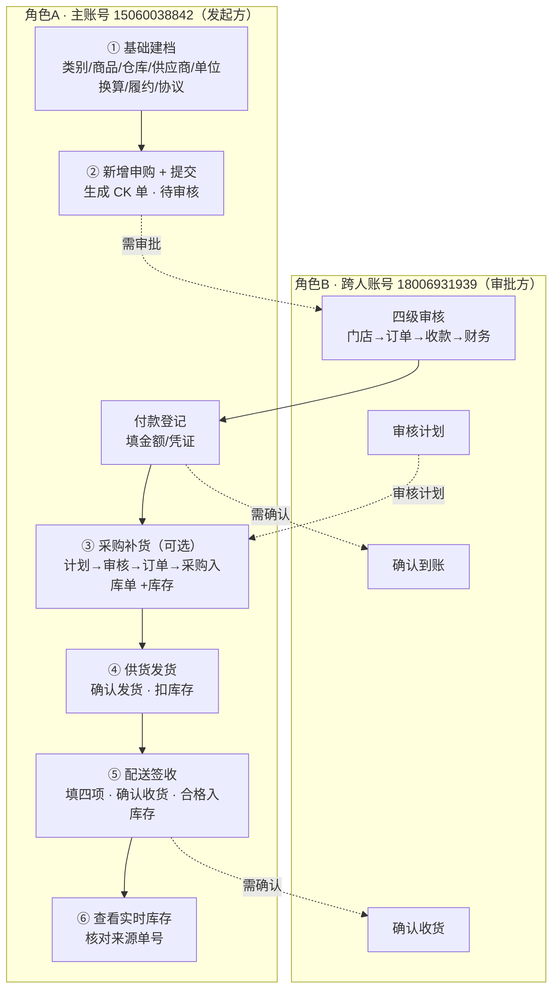
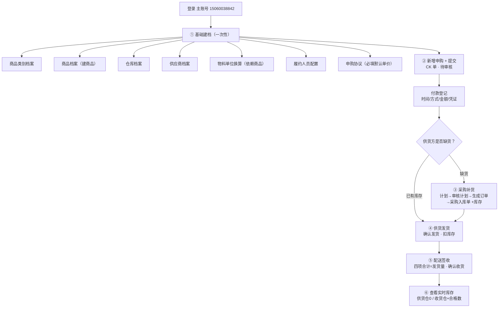
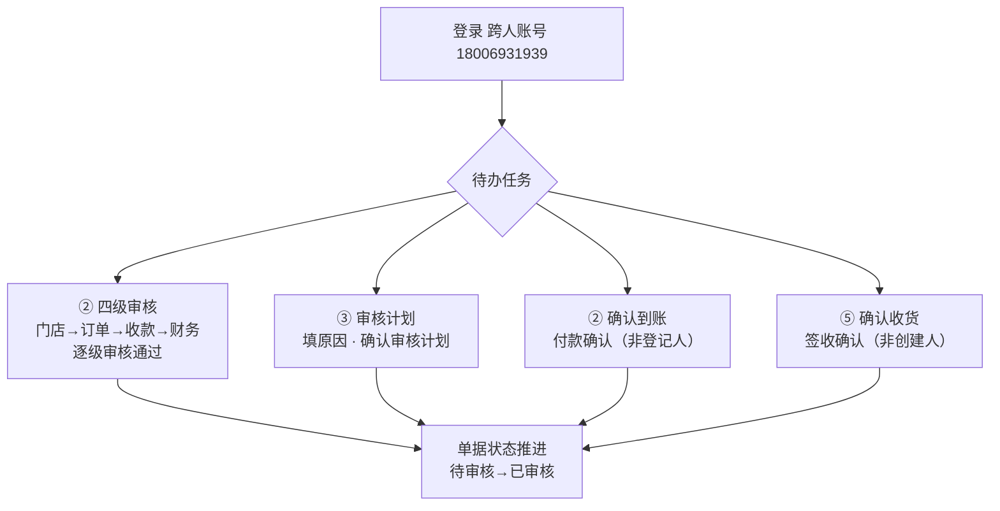

# 采购入库端到端流程 · 角色流程图

> 适用环境：测试环境 `https://oacs.fzjinkuo.com`（business_id=200242「测试」）
> 完整逐步操作见 `docs/采购入库全流程操作手册.md`

## 角色分工（关键纪律）

| 角色 | 账号 | 身份 | 负责动作 |
|------|------|------|---------|
| 发起方 / 建单方 | `15060038842`（陈林航） | `sy-org-admin` | 建档、新增申购、付款登记、采购计划/订单/入库、供货发货、配送签收 |
| 审批方 | `18006931939`（陈林） | `sy-org-staff` | 四级审核、审核计划、确认到账、确认收货 |

⚠️ 纪律：
- **创建人不能审核自己的单**（管理员也不例外，自审必 403/409）。
- **付款登记与确认到账不能是同一人**（三权分立，本人确认必 403）。

---

## 一、总流程图（端到端 6 节 · 含角色标注）

---

## 二、主账号（发起方）操作流程图

---

## 三、跨人账号（审批方）操作流程图

